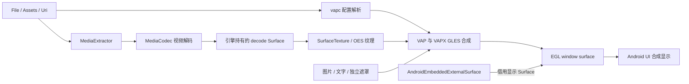
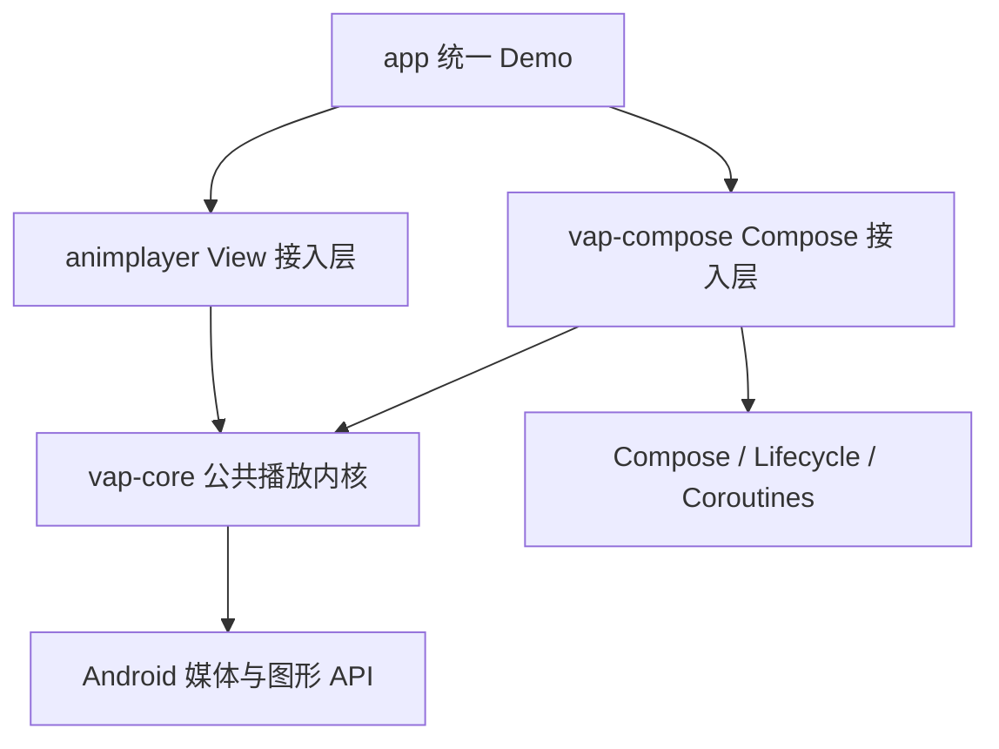

# vap-compose 原生 Compose 渲染技术方案

初稿日期为 2026 年 11 月 3 日。当前 `:app` 是统一 Demo，沿用应用 ID `com.tencent.qgame.playerproj`，从同一首页进入 View 和 Compose 示例。独立 Maven 消费工程位于 `validation/consumer`。

在 `Android/PlayerProj` 从现有播放器提取 Android Library `:vap-core`，承载配置解析、媒体解码、透明合成、VAPX、音频与播放会话。现有 `:animplayer` 作为 View 接入层，新建 `:vap-compose` 作为 Compose 接入层，两者共同依赖 `:vap-core`，维护一套播放内核。

Compose 以 `VapAnimation` 提供声明式入口，默认使用 `AndroidEmbeddedExternalSurface` 接收显示 Surface，再交给公共内核完成 `MediaCodec + SurfaceTexture + EGL + OpenGL ES` 渲染。`vap-compose` 独立发布、不依赖 `animplayer`；“独立”不要求把公共引擎也复制到自己的 AAR 中。

## 目标与边界

这里的原生 Compose 指：组件 API、布局、播放意图、生命周期和交互均由 Compose 管理，渲染出口使用官方 Surface composable。Foundation 在 Android 上仍使用平台 View 实现这些 Surface API；`AndroidEmbeddedExternalSurface` 的内部实现是 `TextureView`。因此，这个方案不承诺底层完全没有 View，也不是把现有 `AnimView` 放进 `AndroidView`。这一边界可由选定版本的 [Foundation 1.9.5 源码包](https://dl.google.com/dl/android/maven2/androidx/compose/foundation/foundation-android/1.9.5/foundation-android-1.9.5-sources.jar)核对。

首个 Compose 正式版本的范围如下，实施阶段可以分批交付，但基础播放原型不等于正式版功能完成。公共内核还须保留 View 端已有能力，不能因 Compose 的首版范围删掉旧功能。

| 能力 | 正式版范围 |
| --- | --- |
| VAP v2 | 读取 MP4 `vapc`，使用 `rgbFrame`、`aFrame` 重建透明视频 |
| 编解码 | H.264 必须支持；HEVC 按设备实际能力选择，不支持时返回明确错误 |
| Compose 行为 | 普通重组不重播，支持尺寸变化、透明叠加、裁剪、变换和列表复用 |
| 播放控制 | 播放、暂停、重播、有限或无限循环、静音、完成与失败事件 |
| VAPX | 图片、文字、逐帧视频遮罩、`z` 顺序、`mt` 旋转以及资源点击 |
| 独立遮罩 | 运行时遮罩替换、移除及可选边缘模糊 |
| 数据源 | 本地 File、Assets、可随机访问的本地 `content://` Uri |
| 音频 | 可选音轨，音画使用同一时间轴，生命周期停止时停止输出 |
| 暂不支持 | 无 `vapc` 的 v1 素材、旧 YUV 兼容路径、网络视频流、DRM、任意 seek、倍速、后台播放和跨平台 Compose |

v1 配置和 YUV 兼容实现迁入 `vap-core`，由 View 接入层保留既有开关；Compose 首版采用严格 v2 策略，遇到缺失或不兼容的配置时返回错误，不自动猜测拼接方式。VAPX 图片可以由业务通过网络加载，但播放器本身不引入网络库或图片框架。

## 拆分前工程对设计的约束

| 当前实现 | 对新模块的影响 |
| --- | --- |
| 拆分前工程只有 `app`、`animtool`、`animplayer` | 新增 `vap-core`、`vap-compose`，保持依赖单向。统一 Demo 直接依赖两个接入层 |
| [AnimPlayer](../animplayer/src/main/java/com/tencent/qgame/animplayer/AnimPlayer.kt) 持有 `IAnimView`；[Decoder](../animplayer/src/main/java/com/tencent/qgame/animplayer/Decoder.kt) 从 View 取得 SurfaceTexture | 现有播放器不能直接充当无 View 依赖的引擎，需要新的宿主和输出 Surface 接口 |
| [Render](../animplayer/src/main/java/com/tencent/qgame/animplayer/Render.kt) 和 [EGLUtil](../animplayer/src/main/java/com/tencent/qgame/animplayer/EGLUtil.kt) 接收 SurfaceTexture，并自行创建、释放 Surface | 新引擎直接接收借用的显示 Surface，EGL 层不得释放宿主 Surface |
| [HardDecoder](../animplayer/src/main/java/com/tencent/qgame/animplayer/HardDecoder.kt) 已区分解码 SurfaceTexture 和显示出口 | 保留两级 Surface 管线，不能让 Codec 直接向显示 Surface 输出拼接视频 |
| [SurfaceFrameTracker](../animplayer/src/main/java/com/tencent/qgame/animplayer/SurfaceFrameTracker.kt) 已按实际锁存时间戳匹配帧 | 下沉到 core，仅维护一份有界映射与跳帧处理 |
| [VapcBoxReader](../animplayer/src/main/java/com/tencent/qgame/animplayer/file/VapcBoxReader.kt) 和 [AnimConfig](../animplayer/src/main/java/com/tencent/qgame/animplayer/AnimConfig.kt) 已有长度、数量和尺寸校验 | 解析规则与测试下沉，旧公开类型通过适配层保留 |
| [MixAnimPlugin](../animplayer/src/main/java/com/tencent/qgame/animplayer/mix/MixAnimPlugin.kt) 已有异步加载、超时、取消、迟到资源归还和目标尺寸提示 | 资源调度下沉；移除其对 `AnimView` 的类型转换，以宿主传入的几何数据估算尺寸 |
| [ScaleTypeUtil](../animplayer/src/main/java/com/tencent/qgame/animplayer/util/ScaleTypeUtil.kt) 与 [MixTouch](../animplayer/src/main/java/com/tencent/qgame/animplayer/mix/MixTouch.kt) 依赖 View 布局或 MotionEvent | 使用 Compose `ContentScale`、`Alignment`、指针输入及同一套几何变换重建 |

已有稳定性修复见 [实施记录](performance-memory-stability-implementation.md)。提取 core 时保留其中的会话隔离、异常释放和帧对齐约束，现有真机结果不代表模块拆分后已经通过验证。

## 渲染出口选择

| 方案 | 适用性 | 结论 |
| --- | --- | --- |
| `AndroidView { AnimView(...) }` | 能快速兼容旧播放器，但仍依赖旧 View 生命周期 | 不采用 |
| `AndroidEmbeddedExternalSurface` | 参与 UI 层级的 GPU 合成，适合夹在背景与前景组件之间，并参与 `graphicsLayer` 效果 | 默认出口 |
| `AndroidExternalSurface` | 独立系统合成层，具有潜在功耗优势；层级相对整个窗口，不能直接等同于普通 Compose 子节点的 `zIndex` | 预留内部宿主接口，正式首版不开放切换 |
| Compose Canvas 每帧绘制 Bitmap | 需要把解码视频转换或读回为图像，增加逐帧传输、分配和同步 | 不采用 |
| `RuntimeShader` 或 `drawWithCache` 直接处理视频 | 不能仅靠这些 API 把任意 OES 解码纹理接入通用的 Compose 绘制链路 | 不作为基础方案 |

Embedded 方案会增加相对独立合成层的 GPU 合成和带宽成本，选择它是为了透明礼物、贴纸等 UI 叠加场景。后续只有在明确不需要跨组件层级和复杂裁剪时，再评估 External 出口。[官方 Surface API 说明](https://developer.android.com/reference/kotlin/androidx/compose/foundation/AndroidExternalSurface.composable)

### 像素管线



显示 Surface 接收的是已经合成为 RGBA 的动画。Codec 的输出对象是引擎持有的 `decodeSurface`，其消费者是 OES 纹理；两者的所有权、尺寸和生命周期必须分开命名与管理。

## 模块结构与复用方式

采用以下依赖关系；箭头表示模块依赖，不表示共享同一个播放器实例。



`vap-core` 不反向依赖任何接入层。它是 Android Library，不是纯 Kotlin/JVM 模块：保留 `MediaCodec`、`Surface`、`SurfaceTexture`、`Bitmap` 和 EGL 等平台能力，但不引用 `View`、`TextureView`、`MotionEvent`、Composable、`Modifier` 或 UI 宿主生命周期。两个前端分别创建引擎实例，不能用全局单例共享当前 Surface、会话或音频状态。

模块职责与 Demo 目录如下。

```text
Android/PlayerProj/
├── vap-core/                    公共内核，minSdk 16
│   └── src/main/kotlin/com/tencent/qgame/vap/core/
│       ├── model/               数据源描述、配置、请求与错误
│       ├── spi/                 两种接入层使用的窄接口
│       └── internal/
│           ├── engine/          会话、时钟、命令与释放
│           ├── source/          数据源句柄与随机读取
│           ├── config/          MP4 box、v2 及旧格式配置
│           ├── codec/           视频、音频、旧版 YUV 兼容
│           ├── render/          EGL 后端、OES、shader、几何
│           ├── mix/             VAPX 资源、图层与命中数据
│           └── mask/            独立遮罩
├── animplayer/                  现有模块名和 Maven vap 坐标保留
│   └── src/main/java/com/tencent/qgame/animplayer/
│       ├── AnimView.kt          View 生命周期、XML 与布局
│       ├── AnimPlayer.kt        原公开入口的兼容外观
│       ├── textureview/         View Surface 宿主
│       └── ...                 原类型、监听器和资源接口适配
├── app/                         统一 Demo，minSdk 23
│   ├── src/main/                首页、共用素材、View 和 Compose 示例
│   └── src/debug/               调试入口和旧 View 稳定性套件
├── vap-compose/                 Compose 接入层，minSdk 23
│   ├── build.gradle.kts
│   ├── consumer-rules.pro
│   └── src/
│       ├── main/kotlin/com/tencent/qgame/vap/compose/
│       │   ├── VapAnimation.kt
│       │   ├── VapPlaybackState.kt
│       │   ├── VapEvent.kt
│       │   ├── VapResourceProvider.kt
│       │   └── internal/
│       │       ├── host/        Compose Surface 与生命周期
│       │       ├── adapter/     请求、状态、资源与 core 桥接
│       │       └── input/       Compose 手势与 semantics
│       ├── test/
│       └── androidTest/
└── validation/consumer/        通过 Maven 坐标验收单端消费和共存
```

### 现有代码的拆分归属

| 现有部分 | 目标位置 | 拆分动作 |
| --- | --- | --- |
| `AnimConfig`、`AnimConfigManager`、`VapcBoxReader`、`file/*` | core 的 model、config、source | 配置解析与句柄管理下沉；保留旧类作为公开 API 适配 |
| `HardDecoder`、`AudioPlayer`、`YuvFrame`、`SurfaceFrameTracker` | core 的 codec、engine | 不再持有旧 `AnimPlayer`，改依赖内核会话和明确的渲染端口 |
| `Render`、`YUVRender`、shader、EGL、纹理工具 | core 的 render | 接收借用的 `Surface`；平台 API 分版本封装 |
| `MixAnimPlugin`、`MaskAnimPlugin` 及资源调度 | core 的 mix、mask | 以配置、资源端口和几何快照工作，不从 View 查询状态 |
| `AnimPlayer` 的会话、循环、停止和释放逻辑 | core 的 engine | 提取为 `VapEngine`；原类保留入口与参数、事件转换 |
| `AnimView`、`IAnimView`、`InnerTextureView`、XML 属性 | animplayer | 创建输出 Surface、管理 View 及兼容接口 |
| `ScaleTypeUtil` | 两层拆开 | `FrameLayout.LayoutParams` 留在 View 层；纯几何计算进入 core |
| `MixTouch`、`IAnimPlugin.onDispatchTouchEvent` | 两层拆开 | MotionEvent 和手势消费留在 View 层；坐标命中算法和帧快照进入 core |
| Compose State、Effect、ContentScale、pointerInput | vap-compose | 转换为 core 请求、几何与控制命令，不复制解码或 shader |

源码和相关测试只迁移一份，并保留版权声明。迁移完成后两端都调用 core 的真实引擎；不能只把解析工具搬出去，却留下两套播放器、VAPX 调度和 EGL 释放逻辑。

### 内核与接入层的接口

core 对外提供少量不可变模型及供两个接入层调用的 `spi`。跨 Gradle 模块使用的声明不能只标 Kotlin `internal`，也不通过 friend path 或重复 sourceSet 绕过模块边界；SPI 使用必要的 public 可见性，文档标明与三个产物一起维护版本，具体实现仍为 internal。

| 契约 | 内容与责任 |
| --- | --- |
| `VapRequest` / `PlaybackOptions` | 数据源、轮次、音频与格式策略；不包含 View、Modifier 或 LifecycleOwner |
| `OutputTarget` / `OutputToken` | 借用 Surface、尺寸和 generation；attach 返回唯一 token，resize / detach 只能操作所属 token |
| `RenderGeometry` | 数值尺寸、矩阵和裁剪区域；两端的布局类型先转换再传入 |
| `VapEngine` | prepare、start、pause、stop、attach、resize、detach、release；命令串行执行并带会话编号 |
| `DetachCompletion` | 撤销输出立即生效，完成信号仅表示不再访问该显示 Surface；不等待整个媒体会话释放 |
| `CoreObserver` | 配置准备、解码帧、提交帧、状态和终结原因等事实；接入层映射线程和业务回调 |
| `ConfigDecision` | 准备阶段的继续或拒绝结果；View 执行旧配置回调后返回结果及允许的配置调整，core 重新校验，控制线程不阻塞等待 UI |
| `CoreResourceProvider` | 可取消异步请求及图片租约；core 统一处理超时、只接收一次和迟到归还 |

core 使用已有的 HandlerThread 和回调管理工作，不要求 Flow、Compose Runtime、Lifecycle 或 `kotlinx-coroutines-android`。Compose 端将 suspend 图片提供者桥接为 core 的可取消资源请求，再把 core 事件转换成 StateFlow 与主线程事件；View 端适配原 `IFetchResource`。core 传出的事实快照不含可被两端并发修改的配置对象。

“需要准备 Surface”“View 隐藏”“页面退出后重播”等是接入层职责。core 不再调用 `animView.prepareTextureView()`，不读取 `isDetachedFromWindow`，也不将完成事件与移除 TextureView 绑定。

### View 兼容边界

现有 `AnimView`、XML 名称、`IAnimListener`、`IFetchResource`、`Resource`、`MaskConfig`、`IFileContainer` 及相关 Java 可见签名保留，通过真实包装类或适配器连接 core。不能简单改包名，或用 Kotlin `typealias` 替代原有 JVM 类来宣称二进制兼容；typealias 不会创建新类型。[Kotlin 类型别名说明](https://kotlinlang.org/docs/type-aliases.html)

原项目也公开了 `AnimPlayer`、`Decoder`、渲染器及部分可变字段，需先生成发布 API 清单，逐项确认包装和行为约束。Demo 编译通过不能代替 ABI 检查；无法兼容的条目须显式列为版本变更，不能在本次提取中静默删除。

旧 `onVideoConfigReady` 的返回值、允许的配置调整、工作线程回调、失败后完成通知、默认拉伸、静音不启动音频和 v1 开关等，均由 View 适配层保留。core 报告明确的终结原因和解码/提交阶段，Compose 采用本文的新事件契约，不强迫旧 API 同步改为主线程回调或改变完成语义。

拆分阶段先保持原有行为，再单独提交公共渲染、暂停或音画时钟改进。需要保持的产品默认值使用明确选项表达；真正的引擎缺陷修复则由两端共同回归，避免因保兼容永久维护两套 shader 或解码流程。

## 构建与发布方案

### 兼容基线

| 项目 | 当前工程 | 新模块方案 |
| --- | --- | --- |
| AGP | `8.12.0` | 沿用 |
| Gradle | `8.14.2` | 沿用 |
| Kotlin | `2.2.21` | 沿用 |
| Compose compiler | 未配置 | `vap-compose` 和 `app` 应用 `org.jetbrains.kotlin.plugin.compose`，版本与 Kotlin 一致 |
| Compose BOM | 未配置 | 仅 Compose 端引入 `2025.11.01`，对应 Foundation / UI / Runtime `1.9.5` |
| Lifecycle | 未配置 | 仅 Compose 端候选 [`lifecycle-runtime-compose:2.9.4`](https://developer.android.com/jetpack/androidx/releases/lifecycle#2.9.4) |
| Coroutines | 未配置 | 仅 Compose 端候选 `kotlinx-coroutines-android:1.10.2`；core 不引入 |
| minSdk | 旧库与旧 Demo 均为 `16` | core、animplayer 和独立 `view-only` 消费工程保留 `16`，Compose 库与统一 Demo 为 `23` |
| compileSdk | 旧库与旧 Demo 为 `37` | core 与 Compose 库采用 `36`，现有 animplayer 与 app 保持 `37` |
| Java / Kotlin 字节码 | `1.8` | core、animplayer 和 app 保持 `1.8`，Compose 库为 `17`，Gradle 使用 JDK 17 或兼容版本 |

版本选择以稳定公开 API 和当前工具链兼容性为依据。已核对 [BOM POM](https://dl.google.com/dl/android/maven2/androidx/compose/compose-bom/2025.11.01/compose-bom-2025.11.01.pom) 的上述映射；[Foundation 1.9.5 AAR](https://dl.google.com/dl/android/maven2/androidx/compose/foundation/foundation-android/1.9.5/foundation-android-1.9.5.aar) 的 metadata 要求 `minCompileSdk=35`、最低 AGP `8.6.0`，其 Surface API 无需实验性 opt-in。其他传递依赖仍需在实施阶段统一通过 AAR metadata、编译和 Lint 检查。

现有 `compileSdk 37 + AGP 8.12` 超出该 AGP 官方支持的最高 API 36，新模块不继续扩大这一组合。旧模块的 SDK 配置调整属于单独的构建维护工作。另一方面，官方当前文档明确 Compose 1.12 起要求 `compileSdk 37` 和 AGP 9，因此不直接把最新 BOM 引入现有工程。[AGP 8.12 兼容要求](https://developer.android.com/build/releases/agp-8-12-0-release-notes)、[Compose 构建要求](https://developer.android.com/develop/ui/compose/setup-compose-dependencies-and-compiler)

### 旧 Android 版本兼容

core 的 minSdk 不随 Compose 提升。现代平台实现与兼容实现放在同一引擎的后端中，通过 SDK 检查选择，并隔离较新平台类型的加载：

| 能力 | 新设备路径 | 低版本兼容责任 |
| --- | --- | --- |
| EGL | API 17 起可选 EGL14 | API 16 使用 EGL10 后端 |
| Codec buffer | API 21 起使用 `getInputBuffer` / `getOutputBuffer` | 保留旧 buffer 数组和变更处理 |
| Surface 帧身份 | API 21 起显式提交纳秒时间戳 | 保留单帧在途与锁存确认，避免不可靠的时间戳推断 |
| 音频创建 | API 23 起使用 `AudioTrack.Builder` | API 22 及以下封装旧构造方式 |
| 特殊 v1 素材 | 由格式与能力决定使用 OES 或 YUV | 保留既有 YUV 布局、裁剪、双槽帧池和纹理更新逻辑 |

平台 API 引入版本依据 [EGL14](https://developer.android.com/reference/android/opengl/EGL14)、[MediaCodec](https://developer.android.com/reference/android/media/MediaCodec#getInputBuffer(int)) 和 [AudioTrack.Builder](https://developer.android.com/reference/android/media/AudioTrack.Builder)。Java 字节码目标与 Android API 支持是两项约束，不能只设 minSdk 就假定新 API 可运行。

### Gradle 配置原则

- 根脚本注册与 Kotlin 同版本的 Compose compiler 插件。Compose 库和统一 Demo 启用 `buildFeatures.compose`。
- `vap-compose` 引入 core、Runtime、UI、Foundation、Lifecycle Compose 与 Coroutines。共享 `VapSource` 等模型来自 `core.model`，因其出现在 Compose 公开签名中，使用 `api(project(":vap-core"))`。Compose / Flow 类型使用相应 `api` 依赖，内部实现依赖使用 `implementation`；Compose 版本通过普通 BOM `platform` 对齐，不向消费者强制 `enforcedPlatform`。
- `animplayer` 通过适配器隐藏新 core 类型时使用 `implementation(project(":vap-core"))`；若审阅后的公开签名确实暴露 core 类型，再改用 `api`。core 不依赖两个前端，也不引入 Compose compiler、AndroidX UI 或协程 Android 运行库。
- 示例使用的 `activity-compose` 等 UI 依赖由 app 声明。播放器库不绑定主题、图片加载框架或 Media3。
- 统一 Demo 使用 minSdk 23，直接依赖 `animplayer` 和 `vap-compose`。首页 `com.tencent.qgame.playerproj/.MainActivity` 提供 **Compose Demo** 和原 View 示例入口。调试场景通过首页的 `scenario` 参数进入 Compose。Maven 单端与共存验收使用独立消费工程。
- 不引入 `retain`、内部 Compose API 或实验性 API 作为资源生命周期的必要条件；`remember`、Effect 和稳定的 Surface API 已满足需求。

### 独立发布

发布三个产物，初始采用同一发布列车版本，便于锁定 core 与适配层契约：

| Gradle 模块 | Maven 坐标 | 运行时依赖 |
| --- | --- | --- |
| `:vap-core` | `io.github.qqnp1100:vap-core:<version>` | Android 平台与必要 Kotlin 基础库 |
| `:animplayer` | `io.github.qqnp1100:vap:<version>` | 同版 `vap-core`，保留原坐标 |
| `:vap-compose` | `io.github.qqnp1100:vap-compose:<version>` | 同版 `vap-core` 与 Compose 端依赖 |

各产物发布 AAR、sources、文档、POM 和 Gradle Module Metadata；POM 必须带上 core 传递依赖。Compose 用户只需声明 `vap-compose`，不需引入 `vap`。View 与 Compose 共用一份 core 类，禁止将 core 同时复制或打包进两个前端 AAR。

旧的单 AAR 手工集成方式会受到拆分影响：后续手工集成需同时提供前端 AAR、core AAR 及相应依赖，不能继续声称只复制一个 `vap.aar` 即可。Maven 方式由依赖元数据解决；核心与前端混用版本需有明确兼容矩阵，首次发布只承诺同版本组合。

[发布脚本](../publish-mavencentral.gradle) 按模块指定 artifactId，共享版本设置和发布元数据配置。先本地发布，再通过 [独立消费工程](vap-compose-m4-publication.md) 验证两种前端及共存。

## 对外 Compose API

以下为 Compose 接入层的拟定 API 草案，用于约束行为，尚非可调用实现。`VapSource` 等共享值类型来自 core；Compose 专属 State、Effect、UI 事件与挂起资源接口留在 `vap-compose`。

```kotlin
@Composable
fun rememberVapPlaybackState(): VapPlaybackState

@Composable
fun VapAnimation(
    source: VapSource,
    modifier: Modifier = Modifier,
    state: VapPlaybackState = rememberVapPlaybackState(),
    playbackKey: Long = 0L,
    isPlaying: Boolean = true,
    isActive: Boolean = true,
    iterations: Int = 1,
    audioEnabled: Boolean = true,
    isMuted: Boolean = true,
    contentScale: ContentScale = ContentScale.Fit,
    alignment: Alignment = Alignment.Center,
    resourceProvider: VapResourceProvider? = null,
    resourceKey: Long = 0L,
    mask: VapMask? = null,
    enableResourceClicks: Boolean = false,
    onEvent: (VapEvent) -> Unit = {},
)
```

| 参数或类型 | 约定 |
| --- | --- |
| `VapSource` | File、Asset、Uri 的不可变描述；包含内容标识及可选 revision。文件在一次播放期间不可原地改写 |
| `playbackKey` | 改变时从头发起一次新播放；相同值的普通重组不重播 |
| `iterations` | 总播放次数，`1` 为一次，`-1` 为无限，其余非正值立即报告参数错误 |
| `isPlaying` | 控制当前播放的暂停与恢复，是唯一播放意图来源；不再同时提供会与它冲突的 `state.play()` / `pause()` |
| `isActive` | 控制该宿主是否允许占用播放资源；列表中由业务依据可见性、选中项等决定 |
| `audioEnabled` | 是否解析和解码音轨；关闭后不创建音频资源，改变此值产生新请求 |
| `isMuted` | 有音轨时动态调整音量，不重建视频解码器 |
| `resourceKey` | 图片、文字内容变化需要重新装载时递增；资源提供者以当前请求的实例管理对应资源归还 |
| `enableResourceClicks` | 显式启用资源点击识别；仅设置播放事件回调不会让组件拦截触摸 |
| `VapPlaybackState` | 暴露只读 `StateFlow<VapPlaybackSnapshot>`；一个实例同时只能绑定一个宿主 |
| `VapEvent` | `Started`、`Completed`、`Failed`、`ResourceClick` 等事件，附带 requestId；在主线程串行交付 |

一次请求的身份由 `source + playbackKey + iterations + resourceKey + audioEnabled` 决定。内容比较相同即为同一请求。更换这些值取消旧请求并开始新请求；单独更换 `onEvent` 或 provider 对象不隐式重播。业务需要刷新 provider 的结果时同时修改 `resourceKey`。

重播示例：

```kotlin
var playbackKey by remember { mutableLongStateOf(0L) }
val source = remember { VapSource.Asset("gift.mp4") }
val playbackState = rememberVapPlaybackState()

Box {
    GiftBackground()
    VapAnimation(
        source = source,
        state = playbackState,
        playbackKey = playbackKey,
        modifier = Modifier.size(240.dp),
        onEvent = { event -> handleVapEvent(event) },
    )
    Button(onClick = { playbackKey++ }) { Text("重播") }
}
```

默认 `ContentScale.Fit` 保持动画比例；迁移旧库默认 `FIT_XY` 的场景需显式传 `ContentScale.FillBounds`。`FIT_CENTER` 对应 `Fit + Center`，`CENTER_CROP` 对应 `Crop + Center`。

`Started` 表示首个视频帧成功提交 EGL 交换，不表示解码器已启动，也不声称屏幕已实际扫描显示。`Completed` 只表示自然播放完成；失败仅交付一次 `Failed`，替换请求、离开页面和主动中断不冒充完成。

## Compose 状态与生命周期

### Effect 的职责

| API | 用途 |
| --- | --- |
| `remember` | 保存轻量状态和控制器身份；构造阶段不创建线程、Codec 或 EGL |
| `DisposableEffect` | 成功进入组合后绑定运行时，退出时撤销宿主并开始幂等清理 |
| `LaunchedEffect` | 以请求身份为 key 提交准备、替换任务；取消准备任务时关闭资源 |
| `rememberUpdatedState` | 让长生命周期事件分发器读取最新回调，避免回调变更导致重播 |
| `SideEffect` | 将最新暂停、静音、布局和遮罩参数幂等同步给稳定控制器 |
| `LifecycleStartEffect` | 在 `STARTED` 期间允许播放；`onStopOrDispose` 撤销生命周期许可 |
| `collectAsStateWithLifecycle` | 业务需要显示状态时收集快照；渲染器不依赖该收集器驱动视频 |

这些 API 分别处理组合、请求和宿主生命周期，不能只依赖 `ON_DESTROY` 才释放资源。[Compose Effect](https://developer.android.com/develop/ui/compose/side-effects)、[Lifecycle Compose](https://developer.android.com/topic/libraries/architecture/lifecycle)

运行许可由以下条件共同决定：宿主已绑定、生命周期至少 `STARTED`、`isActive`、有效且非零尺寸的 Surface、非终态请求。`isPlaying` 决定在许可内播放还是暂停。组件仍在组合中不代表它在列表可见区域内，库不能通过 Activity 生命周期推断列表项可见性。

在 `isActive=false` 或生命周期未达到 `STARTED` 时，只保存最新请求描述，不继续预加载媒体和图片。首次请求若 `isPlaying=false`，允许解析配置，但推迟创建 Codec，画面保持透明；这里与已经播放后暂停保留末次画面的情况分开处理。

### 状态转换与恢复规则

| 触发条件 | 目标状态 | 资源与恢复行为 |
| --- | --- | --- |
| 新请求 | `Preparing` | 取消旧请求，解析配置并准备资源；相同请求不重复创建 |
| 配置就绪但尚无可用 Surface | `AwaitingSurface` | 不启动视频与音频输出；保留有界的准备结果 |
| 许可满足且 `isPlaying=true` | `Playing` | 开始或恢复时间轴 |
| 许可满足且 `isPlaying=false` | `Paused` | 暂停时钟、视频提交和 AudioTrack；保留当前帧与本会话资源 |
| `ON_STOP`、`isActive=false`、零尺寸或 Surface 丢失 | `Suspended` | 停止输出并释放媒体和 GL 播放资源；保存逻辑请求和已完成循环数 |
| 从 `Suspended` 恢复 | `Preparing` | 从被中断的这一轮起点重播，不重复计算已完成轮数；这不是精确断点续播 |
| 达到播放次数 | `Completed` | 末帧成功交换且时间轴到达本轮终点后清为透明并释放播放资源；普通重组不再次播放 |
| 配置、解码、渲染或资源失败 | `Failed` | 一次终态错误并执行完整清理；修改请求 key 才重试 |
| 离开组合 | 内部 `Disposing → Disposed` | 撤销事件交付，释放媒体、Surface 和线程；新宿主重新绑定时创建新运行时 |

前后台切换与 Surface 重建采用明确的重播策略，首版不保存 Codec、EGL 或图像到 `rememberSaveable`。可保存的是业务请求或重播编号。用户暂停的请求在重新获得许可后仍保持暂停，不能被生命周期恢复自动改为播放。配置变更后是否重建播放由业务保存的请求决定。

状态快照只更新阶段、错误、配置、循环数及节流后的进度，进度默认最多 4 次/秒。帧索引、纹理、资源命中列表属于引擎数据，不每帧写 Compose State。`@Immutable` 只用于真正不可变的值类型；包含 Bitmap、可变集合和生命周期句柄的对象不能通过注解伪装稳定。

## Surface 所有权与销毁协议

两个前端都向 core 提交借用 Surface，core 统一执行渲染和解绑；区别是宿主允许释放 Surface 的时机。下面的同步销毁约束针对 Compose，View 可继续保留它现有的延迟释放行为。

### 对象责任

| 对象 | 所有者 | 释放规则 |
| --- | --- | --- |
| Foundation 提供的显示 Surface | Compose Surface 宿主 | 引擎只借用，不调用 `release()`，不保存在全局或 ViewModel |
| View 根据 SurfaceTexture 创建的显示 Surface | View 接入层 | core 解绑确认后释放 wrapper；宿主 SurfaceTexture 按 TextureView 返回值确定归属 |
| 对应 EGLSurface | 渲染线程 | 宿主撤销时停止提交、解绑并销毁 |
| 解码 Surface、SurfaceTexture、OES texture | 引擎 | Codec 停止使用后按线程与上下文顺序释放 |
| MediaCodec、MediaExtractor、AudioTrack | 各自的媒体工作线程 | 取消和正常完成均走同一幂等收尾路径 |
| 图片资源租约 | 资源提供者授予引擎临时使用权 | 引擎使用完毕后调用租约的幂等 `close()`，不直接回收业务 Bitmap |
| 外部遮罩 Bitmap | 业务方，或显式资源租约 | 不在业务仍可访问时回收；纹理由渲染线程管理 |

### 宿主接入

使用 `AndroidEmbeddedExternalSurface(isOpaque = false)`。`onInit` 仅注册宿主事件，不把 source 或事件回调固定为首次组合的旧值。控制器保持稳定；更换控制器时通过 `key(controller)` 重建 Surface 宿主。

每次 `onSurface` 生成新的 `surfaceGeneration` 和借用记录，先注册 `surface.onChanged`、`surface.onDestroyed`，再提交异步 attach；注册之前不执行挂起等待。`onChanged` 只提交最新尺寸，执行时再次检查 generation，正常 resize 不重建 Codec。默认 Surface 缓冲区跟随布局尺寸，保留未来调整渲染分辨率的内部能力。

View 接入层在 TextureView 可用时自行创建 `Surface(surfaceTexture)`，走同一个 core attach。销毁时先撤销 token，仍可返回 `false` 接管 SurfaceTexture，在 core 的异步 `DetachCompletion` 到达后释放 wrapper 和 SurfaceTexture。core 不回调 View 方法；旧 token 即使已脱离也必须完成自己的释放通知，不能误解绑新 token。

### 销毁必须与实际渲染互斥

Foundation 的销毁回调在主线程运行，要求此时渲染线程停止使用 Surface；选定版本内部会在回调后释放其 SurfaceTexture。旧库通过 `onSurfaceTextureDestroyed` 返回 `false` 延迟接管释放的办法不能照搬到这里。[Foundation Surface 生命周期源码](https://android.googlesource.com/platform/frameworks/support/+/53887e3820ec838ad53801c542894e5a3f1924d3/compose/foundation/foundation/src/androidMain/kotlin/androidx/compose/foundation/AndroidExternalSurface.android.kt)

收尾分为以下步骤：

1. **立即撤销输出许可。** 主线程标记该 generation 无效，阻止后续输出任务入队，唤醒等待者。只设置一个布尔值再异步 post 清理不能消除检查之后仍在执行 `eglSwapBuffers` 的竞态。
2. **完成输出解绑握手。** 向渲染线程提交优先级高于普通帧任务的 detach 控制命令，丢弃旧 generation 的待渲染任务。渲染线程结束正在进行的输出调用，将 EGLContext 切换到预先创建的 1×1 pbuffer，销毁该 window EGLSurface，然后确认。销毁回调返回前必须达到不再访问借用 Surface 的状态。
3. **异步释放媒体。** Codec 停止、Extractor 关闭、资源归还、OES 和其他 GL 对象释放均在输出解绑之后执行，不放进主线程握手中。不能等待需要回到主线程执行的任务，以免死锁。

EGL 配置同时支持 `EGL_WINDOW_BIT | EGL_PBUFFER_BIT`。不依赖可选的 surfaceless-context 扩展，也不在 Surface 已失效后尝试清屏交换。普通停止、完成和替换源在 Surface 仍有效时清为透明；若 Surface 已撤销，则跳过显示输出。

该协议涉及短暂的跨线程同步，无法仅凭设计保证所有驱动的 `eglSwapBuffers` 都快速返回。原型必须测量销毁回调耗时，并注入绘制中的销毁；出现长时间主线程阻塞时，必须调整输出机制后才能继续扩大功能。不能设置一个等待超时后直接返回、同时让旧线程继续写 Surface 的伪兜底。若最终不得不改成自行持有 TextureView，须重新评审本方案的原生 Compose 边界。

## 引擎线程与会话模型

采用稳定控制器协调状态，按以下工作环境分配职责：

| 环境 | 职责 |
| --- | --- |
| 接入层主线程 | View/Compose 的 UI、生命周期、Surface 事件；Compose 在此交付公开事件，View 保留原回调线程契约 |
| core 控制队列 | 串行处理播放命令、会话状态及工作线程结果，不反向调用 UI |
| core 有界 I/O 执行器 | 打开数据源、读取 `vapc`；通过资源端口调度外部提供者，加载并发初始上限为 4 |
| core 专属渲染 HandlerThread | EGL、`updateTexImage`、纹理上传、绘制、交换、GL 删除和输出解绑 |
| core 视频线程与可选音频线程 | 各自串行拥有 Codec、Extractor；音频线程额外拥有 AudioTrack |

EGL 始终在 core 的同一个实际渲染线程上调用。Compose 使用协程发命令或加载资源，不改变 EGL 线程归属，也不通过 `Dispatchers.IO.limitedParallelism(1)` 模拟固定线程。core 控制队列不等待主线程回调完成；Surface detach 的撤销信号与渲染确认采用独立通道，避免主线程等待期间阻塞在普通事件分发上。

视频使用有限超时的同步 dequeue，API 21 以上通过 `getInputBuffer(index)` 访问缓冲；API 16 至 20 的数组访问仅保留在兼容后端。每一步检查取消，控制任务可在步骤之间执行，时间等待可唤醒；不把整个视频的忙循环长期放进不可中断的任务。同步模式与异步 Callback 模式不能混用。[MediaCodec API](https://developer.android.com/reference/android/media/MediaCodec)

每条异步工作携带 `requestId`、`sessionId`；输出工作再带 `surfaceGeneration`，循环帧带 `iteration`。请求变化、恢复和输出重建分别使对应编号失效。旧的资源结果、Codec 回调和渲染任务不能启动、终结或覆盖新会话。

控制命令不得丢失，帧唤醒允许合并：每个播放器最多一个待执行绘制任务；新帧到达时标记 dirty，绘制期间到达的帧仍会安排下一次锁存，避免丢失唤醒。不为每个帧回调创建独立协程，也不建立无限 Channel。

core 的清理状态机独立于 Compose 请求 Job：先撤销许可，再停止媒体生产者，最后释放解码 SurfaceTexture 和 GL 资源。Compose 取消时只提交取消或释放命令，core 保证清理继续运行，线程在所属清理全部结束后退出。View 也走相同路径，不以宿主是否使用协程决定资源能否归还。

## VAP 合成与帧同步

### EGL 与透明度

core 使用 OpenGL ES 2.0 和 `GL_TEXTURE_EXTERNAL_OES`；Compose 所在设备使用 EGL14 后端，API 16 的 View 设备使用 EGL10 后端。统一申请 RGBA8888、alpha 8 位，不申请不需要的 depth/stencil。初始化失败逐项回滚。创建显示目标后先用 EGL 清为 `(0, 0, 0, 0)` 并交换，不能同时用 Canvas 锁定同一个输出 Surface 作为另一个生产者。

一个容易误实现的约定是 **素材 RGB 已经预乘 alpha**。[GetAlphaFrame.getColor](../animtool/src/main/java/com/tencent/qgame/playerproj/animtool/GetAlphaFrame.java) 将原图与黑色背景混合，等价于输出 `rgb × alpha`；现有 [RenderConstant](../animplayer/src/main/java/com/tencent/qgame/animplayer/RenderConstant.kt) 直接组合该 RGB 和灰度 alpha。因此主视频 shader 应输出 `vec4(packedRgb, packedAlpha)`，不能再次将 `packedRgb` 乘 alpha。

新渲染链路统一约定输出为预乘 RGBA：

- 主视频直接采用素材中的预乘 RGB；透明目标上覆盖绘制，明确恢复相应的 blend 状态。
- 上传的 VAPX 图片规范化为预乘格式；视频遮罩值为 `m` 时同时输出 `src.rgb * m` 与 `src.a * m`。纯色文字填充使用 `color.rgb * src.a * m`，避免重复预乘。
- VAPX 图层使用 `ONE, ONE_MINUS_SRC_ALPHA` 的预乘混合约定，不能只替换 blend 因子而保留不一致的旧 shader。
- 独立遮罩对合成后的 RGB 与 alpha 同时生效；有此功能时使用复用的 RGBA FBO 完成最终遮罩 pass，没有遮罩时省去该中间目标。

遮罩语义与 [MaskRender](../animplayer/src/main/java/com/tencent/qgame/animplayer/mask/MaskRender.kt) 保持一致：mask 的 alpha 表示保留比例，`0` 隐藏、`1` 保留。新 pass 在配置的 maskPosition 区域内使用 `visibility = maskAlpha` 同时乘 RGB 和 alpha，区域外保持原画面；根据 maskTex 的矩形与参考尺寸采样，不能默认铺满整张动画。边缘模糊按纹理尺寸换算采样步长，避免固定 UV 偏移导致不同尺寸效果不一致。

### 坐标与 SurfaceTexture 变换

保持三个坐标空间：VAP 逻辑画布 `info.w/h`、拼接视频 `videoW/H`、宿主显示区域像素。先在逻辑画布计算位置，再根据打包矩形生成视频采样坐标。

每次 `updateTexImage()` 后，读取同一张纹理的时间戳和 `getTransformMatrix()`。RGB、alpha、VAPX 视频遮罩统一先完成 VAP 左上原点到 GL 坐标的变换，再应用 SurfaceTexture 矩阵。`mt=90` 只作用于视频遮罩的局部坐标。独立 Bitmap、文字与外部 mask 使用自己的坐标，不套视频变换矩阵。[SurfaceTexture 采样契约](https://developer.android.com/reference/android/graphics/SurfaceTexture#getTransformMatrix(float%5B%5D))

crop、编码对齐尺寸和旋转由明确的坐标约定处理，不直接用 Codec 的 padding 宽高覆盖 `vapc` 的逻辑画布。Compose 首版只承诺经过验证的 VAP v2 打包素材；不支持的旋转或格式组合返回可诊断错误，View 端仍保留经验证的旧格式路径。GPU 初始化时检查 `GL_MAX_TEXTURE_SIZE`、OES 扩展及相关缓冲尺寸，不能只依赖 JSON 尺寸校验。

### 帧身份与播放节奏

1. 从视频输出的呈现顺序确定素材帧索引，排除 codec-config 和空 EOS buffer；含有效画面的 EOS buffer 仍需绘制。VAPX 的 `frame.i` 对应该素材帧索引。
2. 使用媒体 PTS 调度播放，提交前生成单调且唯一的纳秒时间戳；建立 `timestamp → session / iteration / frameIndex / mediaPts` 映射。时间戳作为 Surface 帧身份，媒体 PTS 作为时钟，不能混为一项。
3. API 21 以上调用 `releaseOutputBuffer(index, timestampNs)`，在渲染线程锁存后用实际 `SurfaceTexture.timestamp` 查找对应图层。映射上限沿用 64，淘汰已经被覆盖的帧；重复锁存不重复渲染。API 16 至 20 使用布尔 render 重载，单帧在途等待锁存确认；YUV 路径通过自有帧槽携带素材帧索引。
4. 找不到映射时可绘制基础视频，但跳过该帧融合层并记录诊断；不能使用最近解码帧补画错误的人像或文字。重复缺失超过预设阈值时报告同步错误。
5. 进入下一轮或自然完成前，等待最后一次有效提交的帧完成 EGL 交换确认，而不只是已解码或已锁存。等待可取消，交换确认默认超时 1 秒；超时走失败释放，不永久挂起。VAP v2 按配置 fps 确定末帧展示时长，时间轴至少达到 `末帧 PTS + 1/fps` 后再结束本轮，不能一收到 EOS 就立即清屏。

每帧视频由解码帧可用事件驱动，不用 `withFrameNanos` 强行把每个显示刷新周期都变成一次视频绘制。后续若引入 Choreographer 调度，也只绘制 dirty 帧，保留真实媒体 PTS 和锁存映射。

resize、ContentScale、Alignment 或 mask 更新同样会将输出标记为 dirty，即使当前暂停也要复用已锁存的纹理重绘。只有收到新解码帧时才调用 `updateTexImage()`；纯布局重绘保持原帧身份，不重复发出 Started 或递增播放进度。重复锁存过滤不能错误地拦截这些必要重绘。

## 布局与点击

由 `ContentScale` 计算从逻辑画布到宿主区域的缩放，再由 `Alignment` 与 LayoutDirection 计算偏移。输出 Surface 保持组件布局大小，动画在其中 letterbox 或 crop；不靠反复修改 SurfaceTexture 缓冲尺寸模拟 `FIT_CENTER`。

View 端若已通过旧 `IScaleType` 改变子 TextureView 的尺寸，向 core 传入实际输出尺寸与已经确定的几何，避免 core 再重复执行一次 Fit/Crop。Compose 的布局策略由接入层转换为数值描述，core 只共享几何算法，不引入 `ContentScale` 类型。

同一份 `RenderGeometry` 包含逻辑到显示矩阵、逆矩阵、可见裁剪矩形和版本号，渲染与命中测试共享它。Compose 外层 `graphicsLayer` 的变换由指针坐标系统转换到局部坐标后再进入该逆变换，不能重复应用。

VAPX 绘制按 `z` 正序，点击按可见图层倒序选择最上层。仅发布最近一次成功交换帧的命中快照，不读取解码线程正在修改的 `curFrameIndex`。先剔除留白与被裁剪区域，再做资源矩形命中；首版不承诺像素级透明命中。

`enableResourceClicks=false` 时不安装指针拦截。开启后使用 `pointerInput` 的手势流程，处理取消和滚动竞争，只消费已经接受的资源点击，并通过 `onEvent` 交付 `ResourceClick`。对于穿透到重叠兄弟节点的需求，不能只靠“不 consume”就宣称支持，应由业务统一分发手势或关闭该层点击。必要的可访问性描述和操作通过 `semantics` 提供。

## 配置与资源加载

### 输入源和配置

`VapSource` 只保存描述，不持有打开的流。一次请求按需创建独立的配置随机读取句柄、视频 Extractor 和音频 Extractor，不能共享可变文件游标。文件描述符的 offset 和 length 必须保留，Assets 使用可重复打开的句柄；压缩 Asset 可在 I/O 阶段复制到受预算控制的临时文件。

View 的自定义 `IFileContainer` 通过适配器保留原 `setDataSource`、随机读取和关闭契约，不假设任意业务容器都可复制为新工厂。其最终关闭继续等待视频、音频退出读取；能否重开按原容器实现判定。新 `VapSource` 工厂接口与旧容器适配分别测试。

Uri 仅接受已有访问权限且可 seek 的本地来源，不在播放器内部请求权限。不能 seek 的 Uri 返回 `SourceNotSeekable`，由业务显式转存后重试。输入关闭后必须能够重新打开，以满足循环、重播和前后台恢复。

保留当前 box 解析的 8 MiB 配置预算、10,000 个顶层 box 上限、扩展长度、size=0、完整读取和溢出校验；继续校验维度、帧数、资源数和总帧对象数量。另补资源 ID 引用完整性、帧索引唯一性、矩形边界及支持的旋转值检查。配置畸形与“没有 vapc”分开报告，不从任意 payload 内搜索伪造的 box 头。

### 资源接口

Compose 资源接口使用挂起函数，图片返回带幂等 `close()` 的 `VapImageLease`，文字返回字符串；接入层将它桥接到 core 的可取消回调端口。View 继续接受 `IFetchResource`，在适配层生成相同的资源租约。请求中包含资源 ID、tag、原始尺寸和目标显示像素尺寸；实际网络、缓存和图片解码由业务提供者决定。

目标图片尺寸取该资源在所有帧的最大显示区域，结合当前几何缩放估算；业务可增加采样余量。输入须为可用于 GLES 上传的有效软件 Bitmap，对 `HARDWARE`、已回收或不支持格式进行转换或明确拒绝。上传阶段和资源使用阶段均有尺寸与像素内存预算，不因一次 resize 无限缓存多份纹理。

默认整批资源准备超时为 10 秒，允许取消，最多 4 个并发加载。取消时向提供者传播取消；适配回调式加载器时，迟到或重复返回的租约必须归还，已接受的相同租约不能重复归还。每次请求记录资源所有者，不能用重组后替换的 provider 释放旧 provider 的对象。

资源为空的行为显式定义为透明占位或空文本；异常和超时终止该请求。渲染线程只接收已经准备好的上传任务，不阻塞等待业务加载。文字按素材的字体尺寸、颜色、粗体和布局约定一次性栅格化为纹理，首版不以每帧 Compose Text 叠层代替 VAPX 融合。

运行时 mask 替换使用版本化描述或租约，禁止业务在上传期间原地修改 Bitmap。新纹理在渲染线程完成上传后再替换旧纹理，旧纹理删除与租约归还各执行一次。移除 mask 同样进入渲染命令队列。

## 音频与循环

core 统一负责音频，API 23 以上使用 `AudioTrack.Builder`，低版本使用兼容构造方式，处理 PCM offset、格式变化、短写及取消。Compose 有音轨且 `audioEnabled=true` 时维护独立 Extractor、MediaCodec 和 AudioTrack，静音仅调节音量，取消静音不触发视频重播；无音轨或 `audioEnabled=false` 时不创建音频线程。View 接入层把旧静音行为映射为既有音频启用策略，不因共用引擎自动增加静音播放的解码开销。

音轨可用时以 AudioTrack 播放进度建立主时钟，视频按 PTS 跟随；使用硬件时间戳或经回绕处理的播放帧计数，不以已写入 AudioTrack 的字节数当作已播放进度。无音轨或音轨提前结束后使用连续的单调时钟映射。暂停冻结同一时间轴；恢复重新建立墙钟基准，避免按暂停期间的时间差追赶大量过期帧。

循环由会话协调器统一控制：末帧交换成功且视频时间轴到达本轮终点后结束本轮，音频较长时截断并 flush；音频较短时余下视频静默播放。下一轮同时重置音视频 Extractor、Codec 和时钟；一次轮次只扣减一次。不能让视频线程和音频线程各自修改同一份剩余次数。

播放器只在宿主许可期间输出声音，不创建后台服务。宿主负责与应用既有音频焦点策略协调；样例需要展示该接入点。音轨解码失败默认作为请求失败处理，业务可以改为 `audioEnabled=false` 发起仅视频的降级请求。普通 `isMuted=true` 不代表跳过音轨解码。

## 错误与释放

公开错误至少区分 `InvalidRequest`、`SourceAccess`、`SourceNotSeekable`、`InvalidVapConfig`、`UnsupportedCodec`、`ResourceTimeout`、`ResourceLoad`、`DecoderFailure`、`RenderFailure`、`FrameSyncTimeout`。错误包含阶段、requestId、基础素材信息和底层原因，不把旧库数字错误码暴露为新 API 的唯一契约。

正常完成、取消、失败和宿主释放共享幂等的终结流程。请求替换时立即撤销旧会话的输出许可，新会话可以准备配置，但不得抢用尚未退出的旧 Codec 或 EGL 对象。各释放步骤独立保护，某个 `stop()` 或业务回调抛出异常不能跳过其他清理。

公开事件回调异常隔离并记录，不能反向阻止清理。释放结束需确认 Codec、Extractor、解码 Surface、SurfaceTexture、纹理、shader、FBO、EGLSurface、EGLContext、文件句柄和资源租约的所有权均已结清，再停止线程。Composition 退出后的业务事件默认不再投递。

## 实施阶段与验收

| 阶段 | 实施内容 | 进入下一阶段的条件 |
| --- | --- | --- |
| M0 拆分基线 | 发布 API 清单、现有行为和图像基线、core SPI、模块依赖与版本约束 | 明确旧 ABI、回调语义、minSdk 16 及数据源兼容要求 |
| M1 公共内核提取 | 先迁配置、数据源和纯算法，再迁解码、渲染、VAPX、音频、会话；将 animplayer 改为真实适配层 | 旧 View 全部用例通过，v1/YUV 与低版本路径仍可用，core 无 UI 反向依赖 |
| M2 Compose 出口原型 | 使用同一 core 接 Embedded Surface，验证透明、布局和同步 detach，通过 Demo 复跑 | 普通重组不重建 Codec；销毁无旧 Surface 访问，主线程耗时达到门槛 |
| M3 Compose 完整接入 | State/Effect、暂停重播、资源桥接、点击、mask 与音频控制；公共渲染和时钟改进独立提交 | Compose 功能范围完成；每次 core 行为改进同时通过 View 回归 |
| M4 发布准备 | 三产物本地发布、依赖与 ABI 检查、共存消费、性能与长时稳定性测试 | 两种前端均只维护适配逻辑，core 唯一，发布依赖完整，测试结论可追溯 |

M1 以保持行为为目标，不同时改写所有 shader、音画时钟和旧回调规则。M2 验证 Compose 特有的 Surface 限制，M3 再推进公共引擎改进；每个阶段保持旧 Demo 可运行，从而能够区分“模块提取导致的回归”和“新能力带来的行为变化”。

### 自动化与设备测试

| 层次 | 必须覆盖的场景 |
| --- | --- |
| core JVM | MP4 box 边界及配置预算；尺寸、帧和资源校验；数值几何正逆变换；帧映射上限与重复时间戳；请求和 Surface generation 失效；循环次数；资源租约只释放一次；v1/YUV 帧向量 |
| 引擎测试 | Preparing 中取消；旧资源迟到；Codec configure/start/stop/release 异常；交换失败；无末帧回调；双停止；绘制期间销毁；resize 与旧 generation 乱序；解码和音频退出确认 |
| View 适配回归 | XML 与 Java/Kotlin 调用兼容；配置拒绝与配置调整；原工作线程回调与终结顺序；旧 IFileContainer；静音不启动音频；默认缩放；旧格式与特殊尺寸；detach 后重挂 |
| Compose instrumentation | 同源重组 100 次不重播；回调更新；重播 key；零尺寸恢复；暂停时布局与 mask 重绘；导航退出；前后台切换；Lazy 列表复用；LayoutDirection；裁剪、缩放、旋转；同一个 state 的双宿主拒绝 |
| 视觉 | 明暗和棋盘背景；半透明边缘无重复预乘；RGB/alpha 不同矩形；VAPX 图片与文字；90° 遮罩；Crop 留白与命中；运行时 mask 替换和移除 |
| 音频 | 暂停和静音切换；短音轨与长音轨；循环；前后台恢复；停止后无声音；声明的音画误差阈值 |
| 包与依赖 | 最小应用只声明 `vap` 或 `vap-compose` 的 Maven 坐标即可解析 core 并运行；同时依赖时只有一份 core、无重复类；View 消费端不传递引入 Compose/协程 Android；API/ABI 对照清单通过 |
| 共存 | 同一页面同时播放 View 和 Compose，分别停止、切换源与销毁；一个实例释放 EGL 或音频资源不影响另一实例 |

M1 的 core / View 回归必须覆盖 API 16 的 EGL10、API 17 至 20 的 Codec 兼容路径以及较新设备；低版本使用可兼容的测试运行器或 Demo 驱动，不让测试依赖间接提高库的 minSdk。若缺少低版本设备，记录验证缺口，不能声称保留了完整兼容性。

M2 的 Compose 出口测试 API 23、API 29、API 33 和较新 Android 版本，覆盖至少两类 GPU/厂商设备；模拟器仅补充构建、状态和 UI 检查。同一个 v1 特殊尺寸素材应在 View 端继续成功播放，在 Compose 严格 v2 策略下返回明确不支持错误。

像素测试使用预先生成的固定素材和可控帧输入，避免随意截取正在播放的视频得出错误对比。实际 VAPX 同步测试人为延迟渲染以制造丢帧，确认融合层跟随锁存帧。视觉验证需要检查窗口最终合成结果，不能只验证离屏 FBO 正确。

### 性能与稳定性指标

以下是实施验收目标，不是已经测得的收益：

- 视频帧不经过 CPU Bitmap 读回；没有业务订阅进度时，持续播放不触发逐帧 Compose 重组。
- 帧映射、绘制任务、资源请求均有明确上限，热路径复用矩阵、顶点和缓冲对象。
- 普通重组和非零尺寸 resize 不增加 Codec 创建次数；有限循环严格按约定次数完成。
- Surface 销毁握手记录主线程 P50、P95 和最大耗时；原型压力测试不得出现超过 100 ms 的握手停顿或销毁后写入。该门槛不构成对任意驱动的实时保证。
- 两种前端分别至少完成 200 次源替换、进入退出和前后台循环，无活动播放线程或租约逐轮累积；FD、PSS 和 GPU 相关缓冲按预热后的稳态趋势核对。
- 同一设备、素材、渲染尺寸和音频模式下，先比较拆分前后 View 的首帧延迟、卡顿与内存，再比较同一 core 下 View 与 Compose 的宿主成本，不预设性能一定提升。
- 分别记录解码帧、锁存帧、交换帧和实际显示侧帧时间；`swapBuffers` 次数、`onVideoRender` 次数不能直接命名为屏幕 FPS。

当前模块可用以下命令构建和验证。

```sh
rtk proxy ./gradlew :vap-core:testDebugUnitTest :vap-core:lintDebug :vap-core:assembleRelease
rtk proxy ./gradlew :vap-compose:testDebugUnitTest :vap-compose:lintDebug :vap-compose:assembleRelease
rtk proxy ./gradlew :vap-compose:connectedDebugAndroidTest
rtk proxy ./gradlew :animplayer:testDebugUnitTest :app:testDebugUnitTest :app:assembleDebug
```

实施按“冻结兼容基线 → 提取 core 并让 View 接入 → 验证 Compose Surface → 完成两端共享能力 → 发布三产物”推进。公共内核提取必须先证明旧播放路径可用，Compose 扩展必须先证明 Surface 所有权和销毁协议成立。
